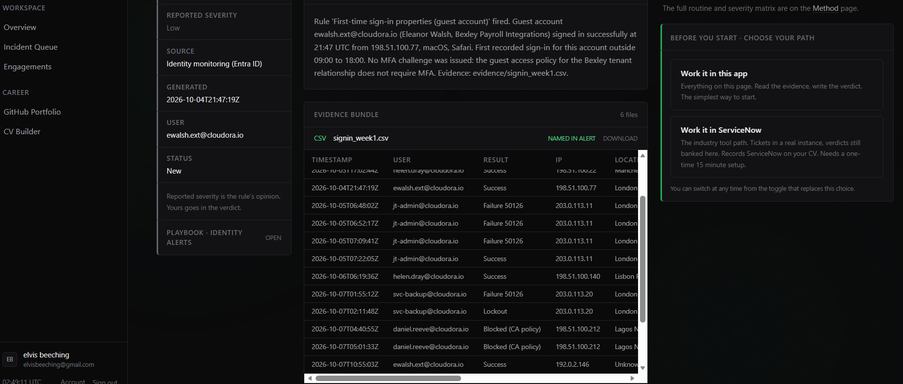
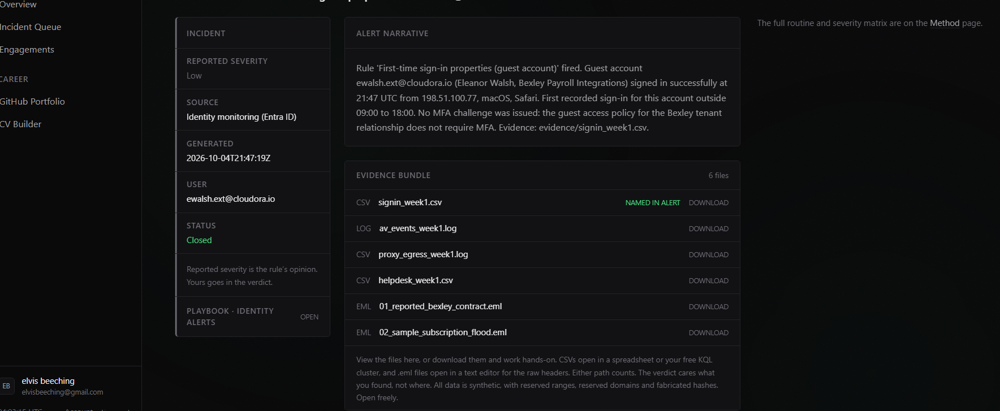
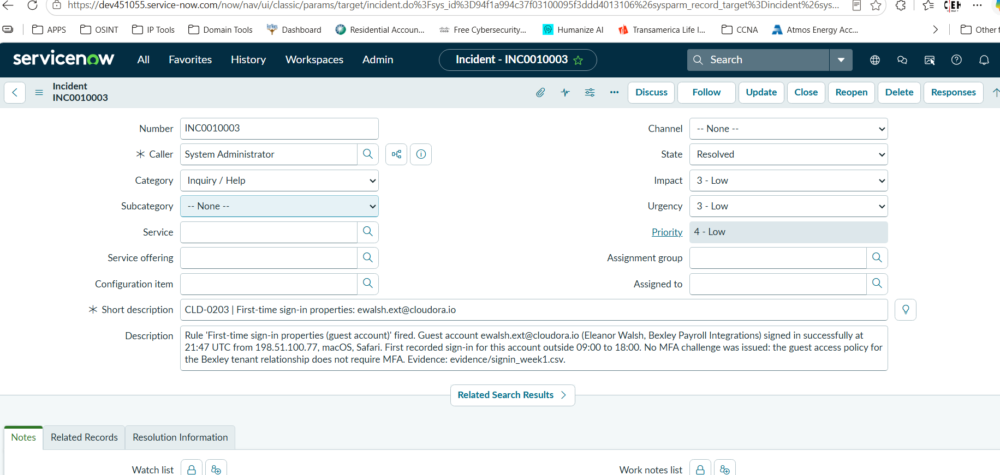

# Guest sign-in baseline review

[Back to portfolio](../README.md)

Simulated training project.

Compared an Entra ID outside-hours guest sign-in alert with historical sessions and identified earlier evening sign-ins matching the same IP and device/browser.

The rule “First-time sign-in properties (guest account)” flagged ewalsh.ext@cloudora.io at 21:47:19 UTC on October 4, 2026. The session used 198.51.100.77, reported as London UK, with macOS/Safari and no MFA under the guest policy.

The supplied CSV records matching baseline sign-ins on September 28 at 18:52 UTC, September 30 at 19:14 UTC, and October 2 at 20:03 UTC. Each was already after 18:00 UTC, contradicting the alert’s “first outside-hours” description if its business-hours window uses UTC.

Download the synthetic sign-in evidence CSV

## Evidence screenshots

Sign-in evidence view used to compare the alerted session and account history.

CLD-0203 alert narrative, Entra ID source, timestamp, and closed status.

ServiceNow INC0010003: guest sign-in incident recorded as resolved.
