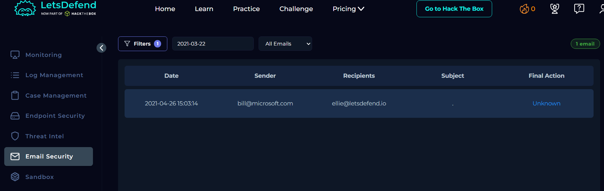
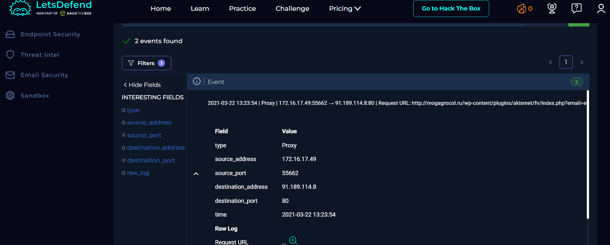
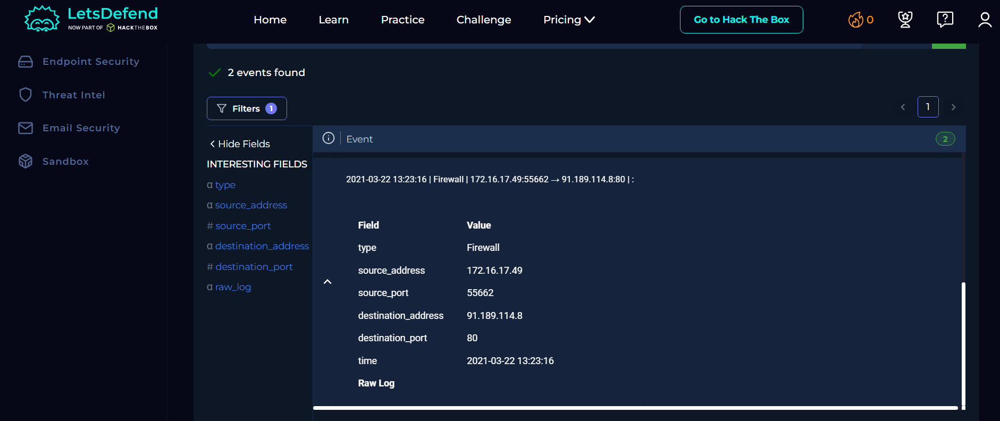

# From suspicious email to network evidence

[Back to portfolio](../README.md)

Simulated training project.

I trace the activity, test the connection, and make every conclusion answer to the evidence.

Investigated a suspected phishing scenario by scoping email records and comparing destination-IP matches across firewall and proxy logs. Documented the observed traffic and distinguished confirmed network activity from an unverified email-to-traffic connection.

LetsDefend training investigation · October 31, 2026. Screenshots below show simulated historical events.

Skills demonstrated: Focused evidence collection, cross-source log comparison, timeline validation, and precise documentation of what the evidence supports.

## Evidence screenshots

Email scoping: one matching message; the displayed email date is April 26, 2021, with final action marked Unknown.

Proxy evidence: HTTP request from 172.16.17.49 to 91.189.114.8:80 at 13:23:54 on March 22, 2021.

Firewall evidence: the same source, destination and ports appear at 13:23:16, 38 seconds before the proxy event.
