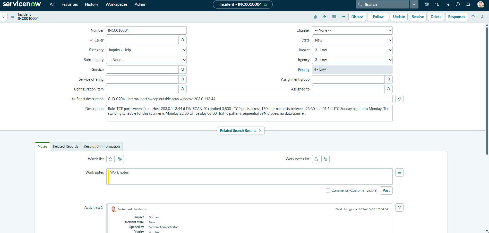
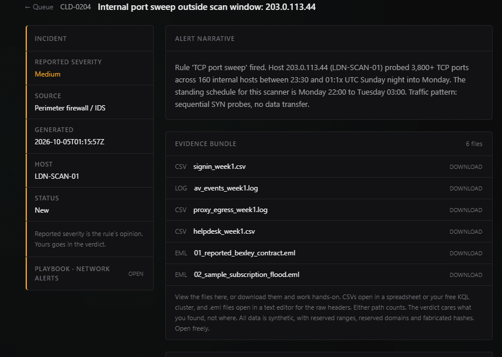
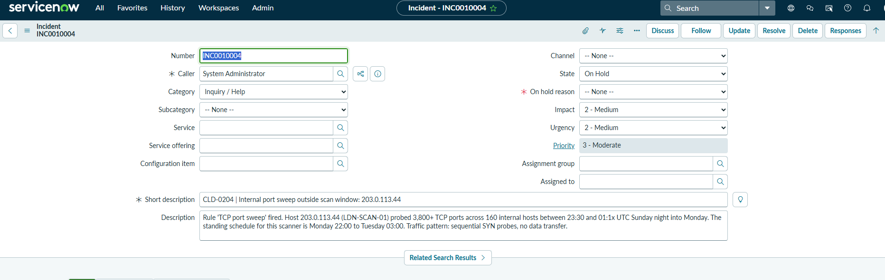
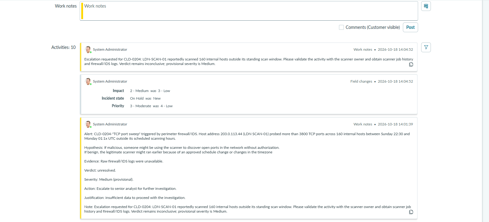
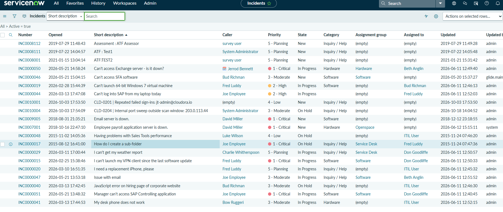

# Out-of-window internal port sweep

[Back to portfolio](../README.md)

Simulated training project.

Triaged a simulated port-sweep alert affecting 160 internal hosts, documented evidence gaps, and recorded an escalation request for senior analyst review in ServiceNow.

Training case · October 18, 2026. This case demonstrates initial triage and escalation under incomplete evidence. It does not establish compromise or a completed senior analyst investigation.

Outcome: Initial triage documented; escalation requested; incident remains On Hold pending further investigation. A known scanner name and absence of reported data transfer do not by themselves establish that the activity was authorized.

## Evidence screenshots

Initial ServiceNow incident and reported scan activity.

Training alert CLD-0204: perimeter firewall / IDS source and scan narrative.

ServiceNow INC0010004 placed On Hold with Medium impact and urgency; Moderate priority.

Seven-field investigation notes and documented senior analyst escalation request.

Incident queue confirms INC0010004 remains On Hold with Moderate priority.
