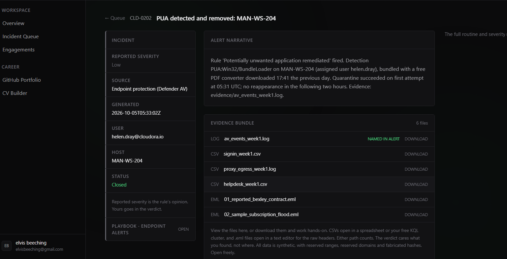
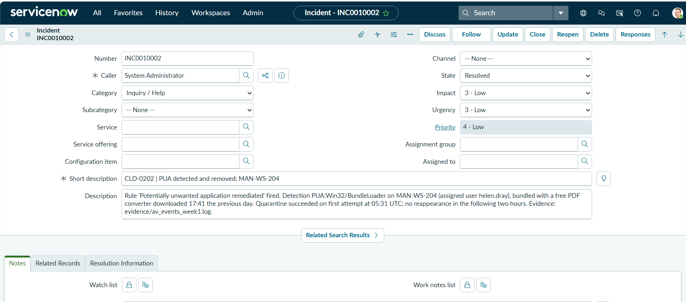
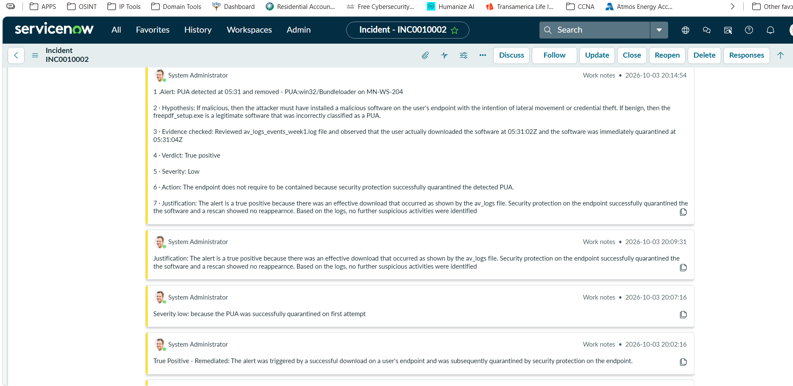

# PUA detection and quarantine

[Back to portfolio](../README.md)

Simulated training project.

Investigated a Defender AV detection of PUA:Win32/BundleLoader on MAN-WS-204 and documented the remediation in ServiceNow incident INC0010002.

The alert describes a potentially unwanted application bundled with a free PDF converter downloaded at 17:41 the previous day. Defender AV successfully quarantined the detection on the first attempt at 05:31 UTC. The alert was generated on October 5, 2026, at 05:33:02 UTC and reports no reappearance over the following two hours.

Evidence clarification: The original work note labels 05:31:02 UTC as a download time. This write-up uses the alert narrative: download at 17:41 the previous day, followed by detection and quarantine at 05:31 UTC. The screenshots preserve the original notes. The AV log itself is not included here, so its exact event timestamps have not been independently rechecked.

## Evidence screenshots

Training alert CLD-0202: Defender AV detection, reported quarantine, and closed status.

ServiceNow INC0010002: resolved incident with low impact, urgency, and priority.

Original seven-field investigation notes: true positive verdict and remediation rationale.
